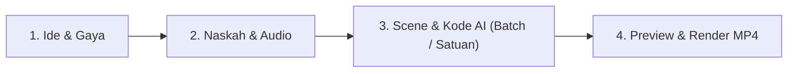
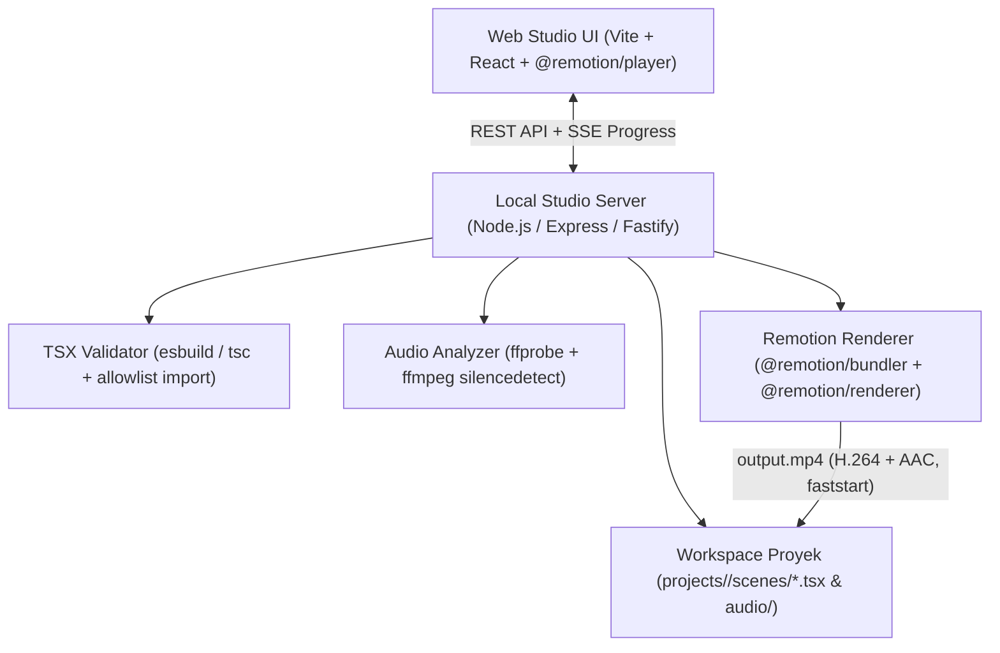

# PRD: Remotion Motion Studio (Web UI Semi-Manual + Local/VPS Render)

**Versi:** 1.0  
**Target Lokasi Proyek:** `E:\remotion`  
**Status:** Draft spesifikasi untuk review sebelum implementasi

---

## 1. Ringkasan Produk

**Remotion Motion Studio** adalah aplikasi web lokal (yang nantinya siap di-deploy ke VPS) di atas engine **Remotion (React + TypeScript + HTML/CSS/SVG + FFmpeg)**. Aplikasi ini menggabungkan kemudahan alur **semi-manual tanpa API key** bersama Claude / ChatGPT / Gemini dan Google AI Studio Speech, dengan kualitas visual studio penuh dari Remotion.

Pengguna tidak perlu mengedit file `.tsx` atau `config.ts` secara manual di code editor. Seluruh alur dilakukan lewat antarmuka web:
1. Menulis/menempel **Naskah** dan memilih **Gaya Visual** serta **Rasio** (`9:16` atau `16:9`).
2. Menempel/mengunggah **Voice-over** (plus opsional **Musik Latar / Ambience**) yang otomatis menyinkronkan durasi scene dan subtitle ke ritme bicara asli.
3. Menyalin **Prompt Remotion hemat token** (per batch 2 sampai 4 scene atau per scene) ke Claude / ChatGPT / Gemini, lalu **menempel kode TSX hasilnya** (per batch atau per scene).
4. Memutar **Preview Video** interaktif langsung di browser, lalu menekan **Render MP4** (H.264 + AAC, 30 fps, `faststart`, bisa di-skip).

---

## 2. Tujuan & Batasan

### Tujuan Utama
- **Tanpa edit file kode manual:** Pengguna cukup salin prompt, tempel kode TSX dari AI, tempel/unggah audio, lalu preview dan render.
- **Hemat token AI:** Batch 1 mengirim kontrak + `MotionKit` + resep gaya ringkas; Batch 2 ke atas memakai mode **lanjutan chat** (< 300 token) agar hemat kuota Claude/ChatGPT/Gemini.
- **Audio dan teks sinkron:** Durasi setiap scene dan cue subtitle otomatis mengikuti panjang audio dan jeda bicara asli (*silence detection*).
- **Tahan error kode AI:** Jika kode TSX yang ditempel memiliki error sintaks/TypeScript, sistem menampilkan pesan error yang jelas per scene tanpa merusak seluruh aplikasi atau menimpa versi scene yang sudah berjalan.
- **Siap lokal dan VPS:** Berjalan di `localhost` sekarang, dengan arsitektur REST API bersih yang siap dibungkus Docker untuk VPS.

### Di Luar Cakupan V1
- Integrasi API berbayar otomatis (OpenAI/Gemini API key).
- Multi-user account/billing SaaS (untuk VPS tahap awal cukup proteksi 1 token/password pribadi).
- Editor keyframe timeline manual ala After Effects.

---

## 3. Alur Pengguna (User Flow)

### Tahap 1: Pengaturan Proyek & Gaya
- Input **Nama Proyek**, **Rasio** (`9:16` 1080x1920 atau `16:9` 1920x1080), dan **Target jumlah scene** (otomatis atau manual).
- Pilih **Gaya Visual** dari galeri (`Kolase Kertas`, `Clay 3D`, `White Catalog`, `Vintage Sketch`, `Cartoon Collage`, `Visual Journalism`, `Cartoon Stage`, `Anime`, `Sinematik`, atau gaya kustom).
- Tombol **Unduh Referensi Gaya** untuk dilampirkan ke chat Claude pada Batch 1.

### Tahap 2: Tempel Naskah & Voice-Over
- **Editor Naskah:**
  - Kotak tempel/tulis naskah langsung (menampilkan jumlah kata & estimasi durasi baca).
  - Tombol cepat **Salin Prompt Naskah & Buka (ChatGPT / Claude / Gemini)** + kotak tempel hasil naskah.
- **Panel Voice-Over (Audio Narasi):**
  - Tombol **Salin Naskah & Buka Google AI Studio Speech** (`https://aistudio.google.com/generate-speech`).
  - Area **Tempel (`Ctrl+V`), Seret (Drag & Drop), atau Unggah File Audio** (`MP3`, `WAV`, `M4A`, `OGG`, `WebM`, maks. 50 MB).
  - Pemutar audio pratinjau + deteksi durasi asli via `ffprobe` dan deteksi jeda hening (`silencedetect`).
- **Panel Musik Latar / Ambience (Opsional):**
  - Unggah file audio musik/suasana (mis. kafe, hujan, musik santai) + slider **Volume** + **Auto-ducking** otomatis saat narator berbicara + *fade-out* 2 detik di akhir.
- **Pembagian Scene Otomatis:**
  - Tombol **Bagi Naskah ke Scene**: memecah naskah menjadi daftar scene, lalu otomatis menyesuaikan durasi tiap scene ke jeda bicara voice-over (bila audio sudah terpasang).

### Tahap 3: Tempel Kode AI (Mode Per Batch & Mode Per Scene)
Pengguna dapat memilih dua cara kerja yang saling terhubung:

1. **Mode Per Batch (Default, Hemat Token):**
   - Pilih ukuran batch: `2`, `3`, atau `4` scene per batch.
   - Toggle **Hemat token (Batch 2+ lanjutan chat)** (aktif secara default).
   - Tiap kartu batch menampilkan:
     - Rentang scene (mis. `Batch 1 · Scene 1-2`), status (`0/2 kode` atau `2/2 siap`), dan estimasi token (`~750 token` / `~220 token`).
     - Tombol 1-klik: **Claude**, **ChatGPT**, **Gemini** (salin prompt batch + buka tab), **Salin Prompt**, dan **Tempel Hasil Batch**.
     - Kotak tempel blok TSX yang memisahkan tiap scene lewat penanda `// ===== Scene01.tsx =====`, `// ===== Scene02.tsx =====` (mendukung fallback penyesuaian nomor scene otomatis bila penomoran berbeda).
     - Tombol **Validasi & Simpan Batch**: memvalidasi sintaks TSX tiap scene, menyimpannya ke `src/scenes/SceneXX.tsx`, dan memperbarui `src/scenes/index.ts`.

2. **Mode Per Scene (Edit / Ganti Satuan):**
   - Daftar seluruh scene (kartu per scene) yang menampilkan:
     - Nomor scene, teks narasi, deskripsi visual, durasi (detik), toggle tema gelap/terang (`dark`), dan status kode (`Valid` / `Error` / `Belum diisi`).
     - Tombol **Salin Prompt Scene Ini** (untuk merevisi atau membuat ulang 1 scene saja tanpa mengulang batch).
     - Editor/kotak tempel **Kode TSX Scene Ini** + tombol **Tempel dari Clipboard** + **Validasi & Simpan Scene**.
     - Tombol **Kembalikan Versi Sebelumnya** (riwayat 1 langkah terakhir per scene agar aman saat bereksperimen).

### Tahap 4: Preview & Render MP4
- **Preview Interaktif:**
  - Menampilkan player Remotion (`@remotion/player` atau tombol buka Remotion Studio) yang memutar sambungan seluruh scene lengkap dengan transisi, voice-over, musik latar, dan subtitle.
  - Toggle **Tampilkan Subtitle** + tombol **Pecah Subtitle Panjang (maks. 2 baris)** + tombol **Sinkronkan Ulang ke Audio**.
- **Render MP4:**
  - Tombol **Render MP4 (`9:16` / `16:9`)** yang memicu proses `@remotion/renderer` di server lokal.
  - Progress bar *real-time* (persentase bundling & rendering frame), tombol **Batalkan**, dan tombol **Unduh MP4** setelah selesai.
  - Verifikasi otomatis via `ffprobe` (menampilkan durasi aktual, resolusi, 30 fps, codec H.264 + AAC, dan ukuran file).

---

## 4. Arsitektur Teknis

### Penyimpanan Proyek (Multi-Proyek Lokal)
Setiap proyek disimpan di folder `E:\remotion\projects\<project-id>\`:
- `project.json`: metadata proyek (nama, rasio, gaya, naskah, daftar scene, durasi, subtitle, pengaturan audio).
- `audio/voiceover.<ext>` dan `audio/bgm.<ext>`: file audio asli.
- `scenes/Scene01.tsx`, `Scene02.tsx`, ...: file komponen TSX tiap scene.
- `scenes/.backup/`: salinan versi sebelumnya saat pengguna menimpa kode scene.
- `out/video.mp4`: hasil render MP4 terbaru.

### API Backend Lokal (`http://127.0.0.1:4100`)
| Method | Endpoint | Fungsi |
|---|---|---|
| `GET` | `/api/projects` | Daftar proyek tersimpan |
| `POST` | `/api/projects` | Buat proyek baru |
| `GET / PUT` | `/api/projects/:id` | Baca / simpan metadata, naskah, gaya, dan daftar scene |
| `POST` | `/api/projects/:id/audio` | Unggah voice-over atau BGM; otomatis ukur durasi (`ffprobe`) dan deteksi jeda (`silencedetect`) |
| `POST` | `/api/projects/:id/sync-audio` | Sinkronkan durasi seluruh scene & cue subtitle ke jeda bicara voice-over |
| `POST` | `/api/projects/:id/scenes/batch` | Parse blok TSX batch (`// ===== SceneXX.tsx =====`), validasi sintaks, simpan semua scene cocok |
| `PUT` | `/api/projects/:id/scenes/:sceneId/code` | Validasi dan simpan kode TSX untuk 1 scene |
| `POST` | `/api/projects/:id/render` | Mulai render MP4 (mengembalikan `jobId`) |
| `GET` | `/api/renders/:jobId/events` | Stream progres render (SSE: bundling, rendering %, selesai/error) |
| `GET` | `/api/renders/:jobId/download` | Unduh file MP4 hasil render |

---

## 5. Keamanan & Validasi Kode AI

Karena pengguna menempelkan kode TSX hasil generate AI:
1. **Validasi Import (Static Check):** Sebelum disimpan atau di-bundle, validator hanya mengizinkan import dari:
   - `react`, `remotion`, `@remotion/*`, `../components/MotionKit`, `../styles`.
   - Menolak import berbahaya (`fs`, `child_process`, `http`, `process`, dll.) serta `fetch`, `eval`, atau akses `window.location`.
2. **Validasi Sintaks Sebelum Simpan:** Menjalankan kompilasi cepat (`esbuild.transform` / TypeScript check) sebelum menulis file. Jika gagal, baris dan pesan error ditampilkan di UI dan kode lama tetap aman.
3. **Kesiapan VPS:** Saat dipindahkan ke VPS, endpoint API dilindungi header `Authorization: Bearer <TOKEN>`, antrean render dibatasi maksimal 1–2 pekerjaan bersamaan, dan proses `@remotion/renderer` dijalankan di dalam Docker container terisolasi dengan batas RAM dan timeout.

---

## 6. Rencana Implementasi Bertahap

- **Fase 1 (Fondasi Server + Penyimpanan & Audio Sync):**
  - Server lokal Node.js di `E:\remotion\server\`, manajemen proyek JSON + folder `projects/`, unggah voice-over & BGM, analisis `ffprobe` + `silencedetect`, serta auto-sync durasi scene dan subtitle.
- **Fase 2 (Parser Batch/Satuan + Validator TSX + Prompt Builder):**
  - Endpoint tempel kode TSX **per batch** (`// ===== SceneXX.tsx =====`) dan **per scene**, validasi static import & sintaks `esbuild`, riwayat undo 1 versi, serta generator prompt hemat token dinamis sesuai gaya.
- **Fase 3 (Web Studio UI + Preview + Render MP4):**
  - Antarmuka web 4 tahap (Ide & Gaya -> Naskah & Audio -> Scene & Kode AI -> Preview & Render MP4), progress bar SSE *real-time*, verifikasi `ffprobe`, dan tombol unduh MP4.
- **Fase 4 (Siap VPS - Opsional):**
  - `Dockerfile` (Node + Chromium + FFmpeg), proteksi token login, dan antrean render aman.

---

## 7. Kriteria Keberhasilan (Acceptance Criteria)

1. Pengguna dapat menempel naskah, mengunggah/menempel file voice-over, dan melihat durasi seluruh scene otomatis tersinkron ke jeda bicara audio.
2. Pengguna dapat menyalin prompt Batch 1 dan Batch 2+ (lanjutan chat hemat token), menempel blok kode TSX dari Claude, dan melihat seluruh scene tersimpan tanpa edit file manual.
3. Pengguna juga dapat mengedit/menempel kode TSX **untuk 1 scene tertentu** secara terpisah.
4. Kode TSX yang error ditolak dengan pesan error jelas tanpa merusak preview scene lain.
5. Tombol **Render MP4** menghasilkan file MP4 valid (H.264 + AAC, 30 fps, `faststart`, bisa di-skip) dengan durasi tepat sesuai voice-over dan audio narasi + musik latar tergabung rapi.
